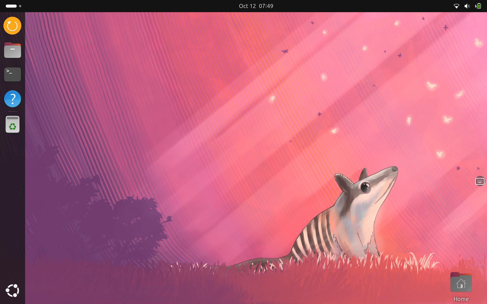
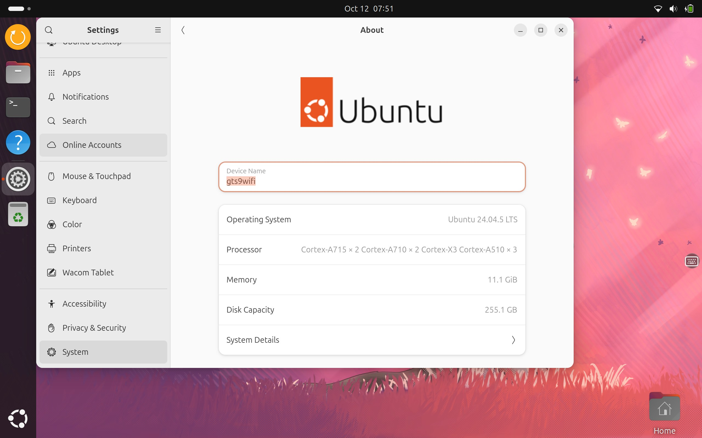
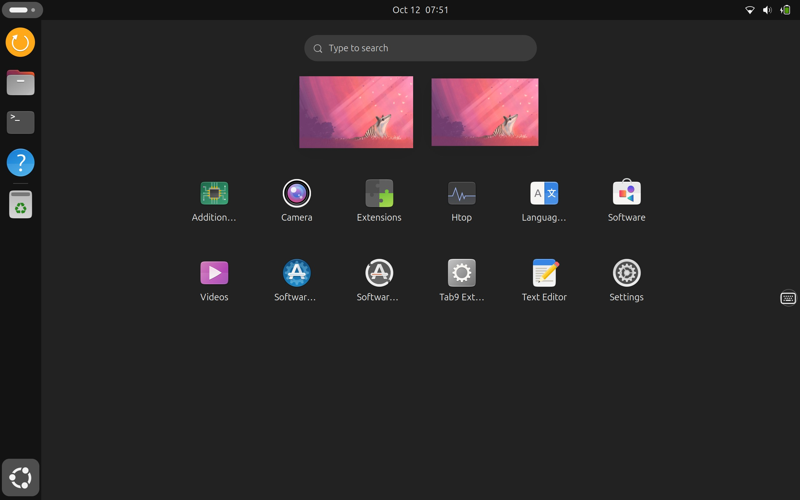

# Ubuntu 24.04 for the Samsung Galaxy Tab S9 Wi-Fi (SM-X710, `gts9wifi`)

> **Alpha.** An open, step-by-step port. Everything here is a reproducible
> recipe: every image in Releases can be rebuilt from this repository with the
> commands in [BUILDING.md](docs/gts9wifi/BUILDING.md), and every patch says
> what it fixes and where it comes from.

Ubuntu 24.04 LTS (GNOME on Wayland, mainline Linux 7.2) booting from a
**microSD card** next to Android on the Galaxy Tab S9 Wi-Fi (Snapdragon 8 Gen 2
/ SM8550). **Android stays installed and its data is never touched.** Switching
between the two only rewrites four boot partitions, and your own Android boot
images are backed up first.

| | |
|---|---|
| Device | Samsung Galaxy Tab S9 Wi-Fi, SM-X710, codename `gts9wifi` (S9+ / Ultra: not supported) |
| SoC | Qualcomm SM8550 (Snapdragon 8 Gen 2), Adreno 740 |
| Kernel | mainline Linux 7.2.0 + gts9wifi drivers and patches |
| Userspace | Ubuntu 24.04 LTS (noble), GNOME 46 on Wayland |
| Root filesystem | microSD; Android untouched on the internal UFS |
| Default login | `ubuntu` / `ubuntu` (change it: `passwd`) |

## Install

One installer zip, two ways to run it: **from the Magisk app** as a module
(recommended), or **in recovery** (TWRP, LineageOS recovery) for tablets
without root. Both do the same install; from Magisk you also get the one-tap
switch to Ubuntu and the fingerprint calibration in one go.

You need:

- an SM-X710 with an **unlocked bootloader**; tested on LineageOS 22
- a **microSD card of 16 GB or more** (it is erased; not one adopted as
  internal storage)
- either a custom recovery with `adb sideload` and a PC with `adb`, or Magisk
  (Magisk 28+ for the action button) with about 5 GB free internal storage

Download `ubuntu-gts9wifi-<version>-installer.zip` from
[Releases](../../releases) and check it: `sha256sum -c *.sha256`.

**From recovery:** put the card in, boot into recovery (*Volume Up + Power*),
start *Apply update → Apply from ADB* (TWRP: *Advanced → ADB Sideload*), then on
the PC: `adb sideload ubuntu-gts9wifi-<version>-installer.zip`

**From Magisk:** put the card in, *Modules → Install from storage*, pick the
zip. (KernelSU and APatch should work the same way; not tested yet.)

The installer, all on the tablet:

1. checks the device, the card and the package (sha256 of every file);
2. **backs up this tablet's own Android boot images**, whatever Android version
   it runs, and builds `android-restore.zip` from them;
3. asks before erasing the card. In recovery: **Volume Up = yes, Volume Down =
   no**. From Magisk: **press a volume key twice = yes, once = no** (Android
   swaps the two keys when the tablet is rotated, so there the number of
   presses counts, not the key);
4. writes Ubuntu to the card and reads it back;
5. builds `ubuntu-boot.zip` and puts both **switch zips** on the card's
   `GTS9W_BACK` partition (from Magisk: also the fingerprint calibration);
6. writes the Ubuntu boot images last, and verifies them.

If anything fails before step 6, the boot partitions are untouched and the
tablet starts Android as before. Reboot: Ubuntu starts, and the root
filesystem grows to the whole card on the first boot.

Already installed from recovery? Install the same zip from Magisk once and
answer **no** (one press) when it asks whether to erase the Ubuntu already on the card: it then only
installs the Magisk module and copies the Android backup and fingerprint
calibration; the card is not erased.

## Switching between Android and Ubuntu

| From → to | How |
|---|---|
| Ubuntu → Android | **Switch to Android** in the dock / app grid (one tap) |
| Android → Ubuntu | **Magisk:** *Modules* → *Ubuntu for Galaxy Tab S9 Wi-Fi* → press its **RUN** (▶ action) button. That is all: it checks, writes, verifies and reboots into Ubuntu. **KernelSU / APatch:** open the module's **WebUI** → *Switch to Ubuntu* |
| emergencies, or no root | flash a **switch zip** in recovery (TWRP) |

Day to day you only need the two buttons above. The recovery zips are the
fallback: when something went wrong, or on a tablet without root.

The switch zips (emergency and no-root path) are on the microSD, in its FAT partition `GTS9W_BACK` (in
Android: the SD card's top folder):

| File | Flash it in recovery to |
|---|---|
| `GTS9W_BACK/android-restore.zip` | go back to **Android**: this tablet's own Android boot images |
| `GTS9W_BACK/ubuntu-boot.zip` | go to **Ubuntu**: the Ubuntu boot images of this card |

They are made on your tablet by the installer and are never downloaded:
the Android images must be the ones of *your* Android build. Each zip asks
Volume Up / Down, writes `boot`, `init_boot`, `vendor_boot` and `dtbo` only,
and verifies them. "Switch to Android" in Ubuntu and the Magisk module use
these same files. Keep them: they are your way back without a PC.

After an Android (or Magisk) update the Magisk module refreshes
`android-restore.zip` by itself at the next Android boot, and again right
before each switch to Ubuntu.

**Fingerprint:** the sensor's factory calibration exists only in Android's
encrypted `/data`, which other recoveries for this tablet cannot read. Installing from Magisk (or
the Magisk module afterwards) copies it to `GTS9W_BACK/fingerprint/`;
Ubuntu installs it at the next boot. Then enrol a finger in *Settings →
Users*.

Details and recovery paths: [DUALBOOT.md](docs/gts9wifi/DUALBOOT.md).

## Screenshots

| | |
|---|---|
|  |  |
|  | |

## What works

Legend: ✅ works, tested on the tablet · 🟡 partial or not retested · ❌ not working

| Area | | Notes |
|---|---|---|
| Display (ANA38407, 2560×1600) | ✅ | GNOME on Wayland, backlight, rotation |
| Touchscreen (FTS1BA90A) | ✅ | multitouch; double tap to wake (< 1 s) |
| S Pen (WEZ01) | ✅ | pressure, hover, **tilt** |
| GPU (Adreno 740) | ✅ | Freedreno / Turnip, Mesa 25.2, Vulkan 1.4 |
| Wi-Fi (WCN6855) | ✅ | 2.4 and 5 GHz, with the tablet's tuned board data |
| Bluetooth | ✅ | the tablet's own address, read from EFS |
| Audio | ✅ | speakers (CS35L45), microphone |
| Battery and charging | ✅ | **80 % charge limit and charge bypass** (Tab9 Extras app) |
| Cameras (front, rear) | ✅ | libcamera + PipeWire, GNOME Snapshot |
| Rear autofocus | ✅ | continuous AF on the DW9808 lens |
| Hardware video | ✅ | iris VPU decode (H.264, HEVC, VP9) and encode (H.264, HEVC) in GStreamer apps; H.264 and HEVC in Firefox |
| Sensors | ✅ | auto-rotation, ambient light, compass |
| Suspend / wake | ✅ | power key suspends and wakes instantly; hold for Restart / Power Off |
| Fingerprint (under-display EL721) | ✅ | unlock, sudo, polkit; needs the calibration step above |
| On-screen keyboard | ✅ | GTK, Chromium, Firefox; floating keyboard button for X11 apps |
| `/vendor` | ✅ | mapped read-only from Android's `super` (firmware source) |
| USB host, docks, DisplayPort | 🟡 | drivers from the Fedora port; not tested on Ubuntu yet — reports welcome |

New in **v0.4.0** ([release notes](docs/gts9wifi/RELEASE-NOTES-v0.4.0.md)):
**Firefox** with hardware H.264/HEVC decoding on the video block (patched
FFmpeg), Google sign-in and Android storage fixed in **Waydroid**, a new
**black hole** boot animation (Galaxy still selectable in Tab9 Extras), and
the screen no longer lights up before an idle suspend.

v0.3.0 ([release notes](docs/gts9wifi/RELEASE-NOTES-v0.3.0.md)) brought
Android apps with **Waydroid** (GPU-accelerated), **PS5/PS4 Remote Play**
with hardware decoding (chiaki-ng), a boot animation instead of kernel
text, ~7 s faster boot, a stable Wi-Fi MAC address, power-key wake fix and
an option to wake without the password.

### Fixed compared to the Fedora port

| Fedora issue | Here |
|---|---|
| Fingerprint blocked at `KEYMASTER_NOT_CONFIGURED` | works: SPU secure start, Keymaster configured, HwVault restored |
| S Pen tilt | works |
| Rear-camera autofocus | works (S9 Ultra libcamera software AF) |
| No charging-bypass UI | charge limit and bypass in the kernel (patch 0007) and in the UI |
| SELinux permissive | not applicable: Ubuntu uses AppArmor, enabled |
| `/vendor` not mounted | mounted read-only (dm-linear over `super`) |
| Players decode video in software | GStreamer apps and Firefox (H.264/HEVC) use the VPU |
| Weak 5 GHz on this unit | tuned board data put into the entry this chip actually loads |
| Android data wiped on install | Android stays; Ubuntu is on the microSD |

## Known issues

- **VP9/AV1 in Firefox decode in software** (YouTube's defaults; Firefox's
  bundled FFmpeg has no V4L2 decoders). Chromium has no V4L2 decoder.
- **After an Android update without the Magisk module**, `android-restore.zip`
  holds the *old* Android boot images: install the zip from Magisk and keep
  the card to refresh it.
- Fingerprint enrolment works, but GNOME Settings does not show its progress
  (about 17 touches).
- XWayland (X11) apps do not open the keyboard on tap: use the floating
  keyboard button or swipe up from the bottom edge.
- Rare GPU fault when switching cameras quickly.
- Linux 7.2.1–7.2.6 break Wi-Fi on this tablet; the kernel stays on 7.2.0.
- No kernel updates through apt yet: a new release is a new image/zip.
- **v0.3.0 only:** Waydroid's Android storage does not mount and the Google
  sign-in hangs; fixed in v0.4.0 (two files to copy on v0.3.0:
  [release notes](docs/gts9wifi/RELEASE-NOTES-v0.4.0.md#already-on-v030)).

Open work and the full history: [KNOWN-ISSUES.md](docs/gts9wifi/KNOWN-ISSUES.md),
[PORTING-LOG.md](docs/gts9wifi/PORTING-LOG.md).

## What this port changes

Kernel patches ([kernel/patches-gts9wifi/](kernel/patches-gts9wifi), each with
its reason and origin), on top of the Fedora port's kernel recipe:

| Patch | What |
|---|---|
| 0001–0004 | HI1337 sensor start/stop timing, DW9808 lens follows the sensor rail, CCI I2C recovery (camera freezes) |
| 0005 | ath11k Wake-on-WLAN suspend: Wi-Fi no longer reboots its firmware on every wake (−1.5 s) |
| 0006 | FTS1BA90A: read the wake gesture after the bus resumes |
| 0007 | SM5714: charge limit and charge bypass (standard sysfs) |
| 0008 | DTS: drop 30 unused memory carveouts (+812 MiB RAM) |
| 0009–0014 | from the S9 Ultra port: q6v5 handover IRQ storm, fastrpc, Adreno fault wait, DPU, DRM bridge, GENI I2C |
| 0015 | q6v5: mask the ready IRQ after the first signal |
| 0016 | qcomtee: large objects (fingerprint secure apps) |
| 0017 | FTS1BA90A: fingerprint area events for the under-display sensor |

Userspace (in [device/](device), installed by
`scripts/build-gts9wifi-rootfs.sh`): power-key service, RTC-offset clock,
Bluetooth address, `/vendor` mapping, sensor start ordering, camera CCI
autosuspend rule, fingerprint secure start and GNOME overlay, the Tab9 Extras
settings app (charge limit, bypass, double tap, keyboard button), on-screen
keyboard fixes, the switch scripts ([dualboot/](dualboot)) and the recovery
zips ([installer/](installer)).

| S9 Ultra port (fork base) | S9 Wi-Fi (SM-X710), this port |
|---|---|
| board-id `0x10008 0x03`, `gts9uwifi` DTS | board-id `0x10008 0x04`, `gts9wifi` DTS |
| WCN7850 Wi-Fi 7 / `ath12k` | WCN6855 Wi-Fi 6E / `ath11k` |
| Goodix touchscreen | ST FTS1BA90A touchscreen |
| Wacom W90xx S Pen | Wacom WEZ01 S Pen |
| ANA38407 AMSA46AS02 panel (2960×1848) | ANA38407 AMSA10FA01 panel (2560×1600) |
| four cameras | two cameras (HI1337 rear + DW9808 lens, HI1337 front) |

## Recovery (OrangeFox)

An OrangeFox recovery for this tablet that **decrypts `/data`** on
LineageOS 22, keeps fastbootd and cannot wipe the Ubuntu card by mistake:
release `recovery-orangefox-1`. What works, limits and how to flash it:
[recovery/RELEASE-NOTES-orangefox-1.md](recovery/RELEASE-NOTES-orangefox-1.md);
the recipe and every patch: [recovery/README.md](recovery/README.md).

## Documentation

- [INSTALL.md](docs/gts9wifi/INSTALL.md) — installing, step by step
- [DUALBOOT.md](docs/gts9wifi/DUALBOOT.md) — how switching works, and how to recover
- [installer/README.md](installer/README.md) — the installer zip, the Magisk module, the switch zips, and testing them without a tablet
- [BUILDING.md](docs/gts9wifi/BUILDING.md) — building every image from source
- [recovery/README.md](recovery/README.md) — the OrangeFox recovery: recipe, patches, status
- [KNOWN-ISSUES.md](docs/gts9wifi/KNOWN-ISSUES.md) — open issues and the work queue
- [PORTING-LOG.md](docs/gts9wifi/PORTING-LOG.md) — what was done, in order, including mistakes

## Safety

This writes to the boot partitions of your tablet. No warranty: you can lose
data or need to reflash your tablet.

- Nothing here ever writes `vbmeta`, the bootloader, `efs`, `modem`, `persist`,
  `super` or `userdata`.
- On this tablet `/dev/block/sda` is the **internal storage**; the microSD
  card is `/dev/block/mmcblk1`. Never write to `sda`.
- If Ubuntu does not boot: recovery → flash `android-restore.zip`, or
  fastboot the Android boot set from a PC ([DUALBOOT.md](docs/gts9wifi/DUALBOOT.md)).

## Credits

This port would not exist without the work of:

- **@nacht20-de** ([gts9wifi-fedora-linux](https://github.com/nacht20-de/gts9wifi-fedora-linux),
  nacht18 on XDA) — the Fedora port for this very tablet: the mainline kernel
  recipe, the X710 drivers and device tree, the device services and the
  firmware research. The kernel side here starts from it.
- **@agcarbajo** ([ubuntu-galaxy-tab-s9-ultra](https://github.com/agcarbajo/ubuntu-galaxy-tab-s9-ultra)) —
  the Ubuntu port for the S9 Ultra; this repository is a fork of it. Build
  tooling, SM8550 work, libcamera autofocus, sensors, mutter and the
  fingerprint stack come from there.
- **@Azkali** ([gts9wifi-firmware](https://github.com/Azkali/gts9wifi-firmware)) —
  fellow Tab S9 porter, whose mainline tree and firmware research helped the
  Fedora port this one builds on.
- **@rainbowdashh** ([android_device_samsung_gts9wifi](https://github.com/rainbowdashh/android_device_samsung_gts9wifi)) —
  the gts9wifi TWRP device tree and partition map; the base of the OrangeFox
  recovery.
- **@lrusak** (Lukas Rusak) and [LibreELEC](https://github.com/LibreELEC/LibreELEC.tv) —
  the FFmpeg V4L2 M2M DRM PRIME series behind Firefox's hardware video
  ([packaging/ffmpeg](packaging/ffmpeg/)).
- **@streetpea** ([chiaki-ng](https://github.com/streetpea/chiaki-ng)) —
  PS4/PS5 Remote Play, patched here for iris ([packaging/chiaki-ng](packaging/chiaki-ng/)).
- **@osm0sis** — AnyKernel3, the model for the recovery zips' loader layout.
- **@topjohnwu** — Magisk and its module format; **@tiann** and the KernelSU
  project for the module WebUI API.
- [Waydroid](https://github.com/waydroid) — Android apps on the tablet.
- The mainline Linux Qualcomm (linux-arm-msm), Mesa Freedreno/Turnip,
  libcamera, postmarketOS (hexagonrpcd, libssc) and Ubuntu communities.

Developed with the help of AI agents (Claude Code). Every component is marked
working only after it has been tested on the tablet.

## License

MIT by default, like both upstream projects ([LICENSE](LICENSE)); per-file
SPDX headers take precedence. Kernel code and patches are GPL-2.0-only, the
device tree is BSD-3-Clause.

Proprietary Samsung/Qualcomm firmware is **not** stored in Git: the build
stages it from the owner's tablet and checks its sha256 (see
[BUILDING.md](docs/gts9wifi/BUILDING.md)). The fingerprint calibration is
per-device and never leaves the tablet and its card.
